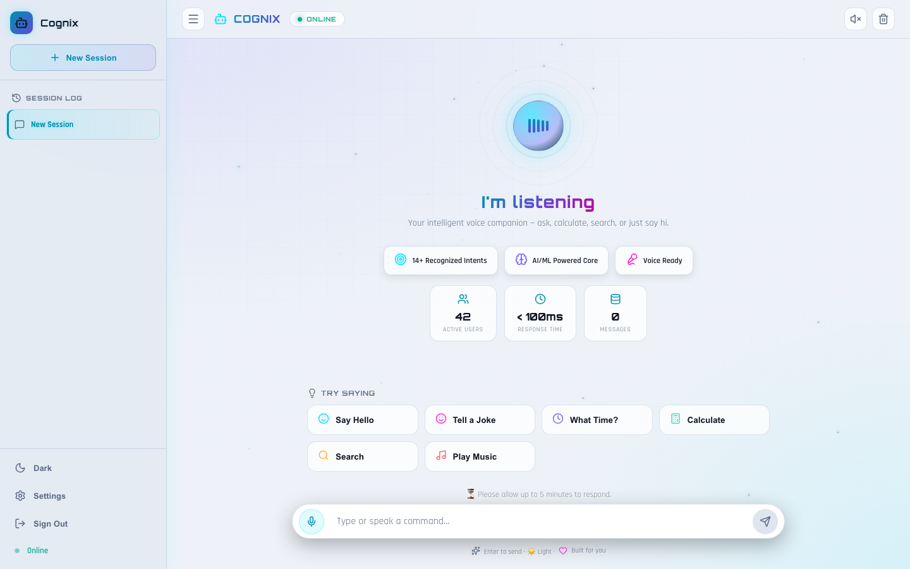

# Cognix — Multi-Lingual Voice AI Assistant (Frontend)

A voice-first assistant that runs in the browser. Speak or type a command, and it recognises the intent and replies in text and speech, in seven languages.

**Live demo:** https://voice-ai-frontend-neon.vercel.app/
**Backend repository:** https://github.com/SachinGaikwad2204/ai-ml-voice-assistant



## Features

- Voice input and spoken replies using the browser's Web Speech API (speech recognition and speech synthesis)
- Seven languages: English, Spanish, French, Hindi, German, Japanese and Chinese, each with its own speech locale
- 14 recognised intents, including greetings, time, weather, jokes, music, search, calculation and translation
- Session log, so earlier conversations can be reopened
- Dark and light themes, and a mobile-first responsive layout
- Settings for voice input, spoken replies and auto-saving sessions

## Tech stack

React 18, Axios, Framer Motion, Web Speech API, Vercel

## How it works

The React app captures speech with the Web Speech API and sends the transcript, session ID and language to the Spring Boot backend at `POST /api/voice/chat`. The backend returns the detected intent and a reply, which the app displays and reads aloud.

## Run locally

```bash
git clone https://github.com/SachinGaikwad2204/voice-ai-frontend.git
cd voice-ai-frontend
npm install
npm start
```

The app opens at http://localhost:3000. By default it calls a backend at `http://localhost:8080/api/voice`. To use a different backend, set `REACT_APP_API_URL` in a `.env` file.

Voice recognition needs Chrome or Edge.

## Note on the demo

The demo backend runs on a free hosting plan that sleeps when idle, so the first reply after a quiet period can take a few minutes.

## Author

Sachin Gaikwad — [Portfolio](https://my-portfolio-ten-orpin-42.vercel.app/) · [GitHub](https://github.com/SachinGaikwad2204)
